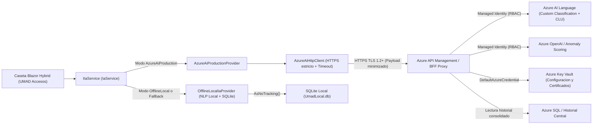
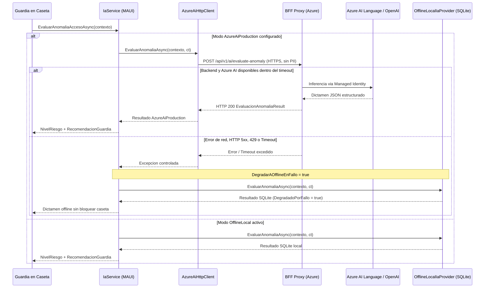

# Arquitectura de Inteligencia Artificial en Producción (Azure AI) — UMAD Accesos v2.0

## 1. Propósito, Porqué y Principios de Diseño

El subsistema de Inteligencia Artificial de **UMAD Accesos v2.0** (`UMADAccesos.Services.AI`) asiste al guardia de caseta en dos tareas críticas sin comprometer la disponibilidad operativa del campus:

1. **Clasificación de motivos de visita en lenguaje natural** (`ClasificarMotivoVisitaAsync`): sugiere categoría institucional (`TipoVisitaSugerido`), área destino UMAD (`AreaDestinoSugerida`), nivel de confianza y si la visita exige aprobación especial.
2. **Detección de anomalías de acceso** (`EvaluarAnomaliaAccesoAsync`): evalúa frecuencia diaria, entradas abiertas sin salida (*tailgating* / registro incompleto), accesos fuera de horario institucional, cambios bruscos de patrón o punto de acceso e intentos reiterados con tokens expirados, revocados o inválidos.

### ¿Por qué desacoplar la IA con Patrón Estrategia y BFF?

- **Operación continua sin internet (*Offline-First*)**: una caseta universitaria no puede detener filas si se cae el enlace celular o Wi-Fi. Por ello, `IIaService` abstrae el proveedor mediante `IIaProvider` y mantiene `OfflineLocalIaProvider` (heurísticas NLP en español + SQLite local) listo para operar de forma primaria o como respaldo automático.
- **Cero secretos en la aplicación móvil**: cualquier API key incrustada en un binario Android, iOS, macOS o Windows puede extraerse mediante ingeniería inversa. La aplicación .NET MAUI **nunca** se conecta directamente a Azure AI ni almacena llaves de suscripción; toda llamada remota atraviesa un **Backend Proxy (BFF)** institucional sobre HTTPS.
- **Evolución gradual hacia modelos entrenados en Azure**: cambiar de `ModoProveedorIa.OfflineLocal` a `ModoProveedorIa.AzureAiProduction` solo requiere configuración no secreta (`IaOptions` + `AzureAiEndpointOptions`), sin reescribir ViewModels, páginas Blazor ni servicios operativos.
- **Garantía no bloqueante**: la IA es una capa de apoyo y alerta temprana; un error de red, timeout o fallo interno **nunca** bloquea el registro físico ni lanza excepciones no controladas en caseta.

---

## 2. Arquitectura de Producción en Azure

### 2.1 Componentes de Azure propuestos

| Capa | Servicio Azure | Responsabilidad principal |
| :--- | :--- | :--- |
| **Cliente móvil** | App .NET MAUI Blazor Hybrid (`IaService` + `AzureAiHttpClient`) | Captura contexto mínimo, valida esquema HTTPS estricto, aplica timeout acotado y degrada a `OfflineLocalIaProvider` si ocurre cualquier fallo. |
| **Perímetro y BFF** | Azure API Management + ASP.NET Core BFF (Azure Container Apps / App Service) | Autentica la sesión del guardia (Microsoft Entra ID / OIDC), aplica *rate limiting*, valida esquemas JSON, minimiza PII y orquesta las llamadas a Azure AI. |
| **Identidad y Secretos** | Managed Identity (`DefaultAzureCredential`) + Azure Key Vault | Elimina credenciales estáticas. El BFF se autentica contra Azure AI vía RBAC de Managed Identity y obtiene parámetros sensibles o certificados desde Key Vault cuando aplique. |
| **NLP de Visitas** | **Azure AI Language** (Custom Text Classification + CLU) | Clasifica motivos de visita en español mexicano (`es-MX`) en las 6 categorías UMAD y extrae la entidad de área destino institucional y palabras clave relevantes. |
| **Anomalías y Recomendación** | Motor determinista BFF + **Azure OpenAI** (salida JSON estructurada) / Anomaly Scoring | Combina reglas deterministas verificables sobre el historial consolidado con evaluación contextual/estadística y redacción de recomendaciones accionables en español para caseta. |
| **Observabilidad** | Azure Monitor + Application Insights | Registra latencia p50/p95, tasa de degradación a offline, códigos HTTP y alertas de seguridad sin almacenar PII ni secretos. |

### 2.2 Diagrama de Arquitectura y Flujo de Datos



### 2.3 Secuencia Operativa con Degradación Automática



---

## 3. Seguridad: Patrón BFF, Managed Identity y Azure Key Vault

### 3.1 Por qué cero llaves en la aplicación móvil

- `AzureAiEndpointOptions` **solo** declara propiedades no secretas: `BackendProxyBaseUrl`, `DeploymentName`, `TimeoutSegundos` y `DegradarAOfflineEnFallo`.
- `AzureAiHttpClient` exige `Uri.UriSchemeHttps` en cada solicitud y rechaza cualquier URL `http://`, vacía o mal formada antes de abrir un socket.
- No existen cabeceras `Ocp-Apim-Subscription-Key`, `api-key`, tokens Bearer embebidos ni cadenas de conexión en el código fuente, recursos empaquetados ni logs.

### 3.2 Autenticación en producción (BFF -> Azure)

1. **Cliente MAUI -> BFF**: sesión institucional autenticada (Microsoft Entra ID / token JWT de corta vida ligado al dispositivo y rol operativo `GuardiaSeguridad` o `AdministradorAccesos`).
2. **BFF -> Azure AI Language / Azure OpenAI**: identidad administrada asignada por el sistema o usuario (**Managed Identity**) con roles de mínimo privilegio:
   - `Cognitive Services User` sobre el recurso de Azure AI Language.
   - `Cognitive Services OpenAI User` sobre el recurso de Azure OpenAI.
   - `Key Vault Secrets User` sobre Azure Key Vault (solo para secretos de integración de terceros o certificados TLS, nunca llaves estáticas de Azure AI cuando RBAC está habilitado).
3. **Aislamiento de red**: despliegue del BFF y servicios de Azure AI con **Private Endpoints** dentro de una VNet institucional, deshabilitando el acceso público a los endpoints cognitivos y a Key Vault.

---

## 4. Contratos REST y Referencia de SDK

Los contratos REST del BFF coinciden directamente con los modelos serializados en `AzureAiHttpClient.cs` (`System.Text.Json`, formato `camelCase`).

### 4.1 Clasificación de Motivo de Visita

- **Endpoint**: `POST https://<bff-institucional>/api/v1/ai/classify-visit`
- **Content-Type**: `application/json`

**Solicitud (`Request`)**:
```json
{
  "deploymentName": "umad-accesos-ia-prod",
  "textoLibre": "Vengo a entregar papelería al área de rectoría",
  "idioma": "es-MX"
}
```

**Respuesta exitosa (`HTTP 200 OK`)**:
```json
{
  "tipoVisitaSugerido": 3,
  "areaDestinoSugerida": "Rectoría",
  "nivelConfianza": 0.94,
  "requiereAprobacionEspecial": true,
  "justificacion": "Visita de entrega de insumos dirigida a un área administrativa sensible.",
  "proveedorUtilizado": "AzureAiLanguage-CLU",
  "palabrasClaveDetectadas": ["entregar", "papelería", "rectoría"]
}
```

### 4.2 Evaluación de Anomalías de Acceso

- **Endpoint**: `POST https://<bff-institucional>/api/v1/ai/evaluate-anomaly`
- **Content-Type**: `application/json`

**Solicitud (`Request` — pseudonimizada, sin PII directa)**:
```json
{
  "deploymentName": "umad-accesos-ia-prod",
  "personaId": 42,
  "puntoAcceso": "Caseta Principal Norte",
  "tipoMovimiento": "Entrada",
  "fechaHoraEventoUtc": "2026-11-26T08:15:00Z",
  "tokenAccesoId": 108,
  "tokenValido": true,
  "motivoValidacionToken": null,
  "registroAccesoActualId": 512
}
```

**Respuesta exitosa (`HTTP 200 OK`)**:
```json
{
  "esAnomalo": true,
  "nivelRiesgo": 2,
  "reglasActivadas": [
    "Acceso fuera de horario institucional permitido (02:15; horario ordinario: 06:30–22:00).",
    "Entrada previa sin salida registrada (posible tailgating o registro incompleto)."
  ],
  "recomendacionGuardia": "Riesgo alto: retener momentáneamente el paso, solicitar autorización fuera de horario y verificar salida pendiente.",
  "proveedorUtilizado": "AzureOpenAI-AnomalyEngine",
  "fechaEvaluacionUtc": "2026-11-26T08:15:01Z",
  "degradadoPorFallo": false
}
```

### 4.3 Códigos de Estado HTTP y Manejo en Cliente

| Código HTTP | Significado en BFF | Acción en `IaService` (`AzureAiProduction`) |
| :--- | :--- | :--- |
| `200 OK` | Inferencia válida | Normaliza campos (`NivelConfianza` en `[0.0, 1.0]`) y devuelve resultado. |
| `400 Bad Request` | Payload inválido | Registra advertencia segura; degrada a `OfflineLocalIaProvider` si está habilitado. |
| `401 / 403` | Sesión expirada o rol no autorizado | Registra advertencia sin credenciales; degrada a offline para no detener caseta. |
| `429 Too Many Requests` | Límite de cuota alcanzado | Registra advertencia y degrada inmediatamente a `OfflineLocalIaProvider`. |
| `500 / 502 / 503 / 504` | Indisponibilidad temporal o timeout | Registra advertencia y degrada a `OfflineLocalIaProvider` con `DegradadoPorFallo = true`. |

### 4.4 Referencia de Implementación del BFF con SDK Oficial de Azure (`.NET`)

```csharp
// Ejemplo referencial para el servicio backend BFF (ASP.NET Core), nunca en la app móvil MAUI.
using Azure;
using Azure.AI.Language.Conversations;
using Azure.AI.OpenAI;
using Azure.Identity;

// Autenticación sin secretos mediante Managed Identity en Azure.
var credential = new DefaultAzureCredential();

var languageClient = new ConversationAnalysisClient(
    new Uri(configuration["AzureAi:LanguageEndpoint"]!),
    credential);

var openAiClient = new AzureOpenAIClient(
    new Uri(configuration["AzureAi:OpenAiEndpoint"]!),
    credential);
```

---

## 5. Presupuesto de Latencia en Caseta

El escaneo de un pase QR en hora pico requiere respuesta ágil para evitar filas en accesos vehiculares y peatonales.

| Etapa del flujo | Objetivo p50 | Objetivo p95 | Límite máximo (Hard Budget) |
| :--- | :---: | :---: | :---: |
| Validación criptográfica local HMAC-SHA256 + SQLite | 8 ms | 20 ms | 50 ms |
| Evaluación offline local (`OfflineLocalIaProvider` + SQLite `AsNoTracking`) | 6 ms | 25 ms | 80 ms |
| Red móvil / Wi-Fi campus + TLS hacia BFF | 60 ms | 180 ms | 1,000 ms |
| Inferencia Azure AI Language (CLU / Custom Classification) | 220 ms | 550 ms | 3,000 ms |
| Inferencia híbrida anomalías (BFF + Azure OpenAI JSON) | 350 ms | 900 ms | 5,000 ms |
| **Total modo `AzureAiProduction` (`TimeoutSegundos`)** | **~650 ms** | **~1,650 ms** | **10,000 ms (configurable)** |

### Regla operativa de latencia

- La validación criptográfica del QR y su persistencia en la cola *offline* se completan localmente antes o en paralelo con la alerta de IA.
- Si el BFF excede `AzureAiEndpointOptions.TimeoutSegundos` (10 s por defecto, acotado entre 1 y 60 s en `AzureAiHttpClient`), el `CancellationTokenSource` cancela la solicitud HTTP y `IaService` responde en menos de 30 ms usando `OfflineLocalIaProvider`.

---

## 6. Privacidad, Minimización de PII y Cumplimiento

1. **Minimización estricta de datos personales (PII)**:
   - En `evaluate-anomaly` solo se envía el identificador numérico pseudonimizado (`PersonaId`), punto de acceso, dirección del movimiento, timestamp UTC y estado booleano de validez del token.
   - **Nunca** se transmiten nombre completo, correo electrónico, matrícula, CURP, contraseña, `PasswordHash`, fotografía de evidencia ni la cadena firmada HMAC-SHA256 del token QR.
   - En `classify-visit` el texto libre se acota a 500 caracteres y se instruye a los operadores a capturar únicamente el motivo institucional, no datos clínicos o financieros confidenciales.
2. **Gobierno de datos en Azure AI**:
   - Azure AI Language y Azure OpenAI operan bajo el contrato empresarial de Azure: las solicitudes y respuestas **no** se utilizan para entrenar modelos base de Microsoft ni de terceros.
   - Se deshabilita el almacenamiento persistente de *prompts* de abuso cuando aplique exención institucional y se fija residencia de datos en región aprobada (por ejemplo, `East US 2` o `South Central US` / `Mexico Central` según disponibilidad del recurso).
3. **Trazabilidad segura**:
   - Todos los logs estructurados (`ILogger`) registran únicamente códigos HTTP, `PersonaId`, nivel de riesgo y número de reglas activadas; jamás escriben tokens, llaves ni cuerpos completos con datos del visitante.

---

## 7. Degradación Automática a Modo Offline y Continuidad Operativa

El servicio `IaService` implementa defensa en profundidad con tres niveles de resiliencia:

| Escenario de fallo | Comportamiento en `IaService` | Impacto en caseta |
| :--- | :--- | :--- |
| `Modo == OfflineLocal` | Ejecuta directamente `OfflineLocalIaProvider` sobre SQLite local. | Cero dependencia de red; todas las 4 reglas de anomalías y clasificación NLP operan al 100%. |
| `Modo == AzureAiProduction` pero sin red, timeout, HTTP 429/5xx o URL no HTTPS | Si `DegradarAOfflineEnFallo == true`, invoca automáticamente `OfflineLocalIaProvider` marcando `DegradadoPorFallo = true` y sufijo `(Degradado desde Azure)`. | Operación ininterrumpida con evaluación completa sobre historial local SQLite. |
| `DegradarAOfflineEnFallo == false` o fallo inesperado en ambos proveedores | `EvaluarAnomaliaAccesoAsync` captura toda excepción y devuelve `EvaluacionAnomaliaResult.SinEvaluacionPorFallo(...)`; `ClasificarMotivoVisitaAsync` devuelve `TipoVisitaSugerido.Otro` con `RequiereAprobacionEspecial = true`. | **Nunca bloquea el acceso ni provoca cierres inesperados de la app.** El guardia aplica protocolo visual estándar. |

### Reglas deterministas preservadas en modo Offline

Incluso sin conexión a Azure, `OfflineLocalIaProvider` garantiza las 4 reglas institucionales verificables directamente sobre SQLite (`UmadDbContext` con `AsNoTracking()`):

1. **Exceso de entradas diarias**: entradas autorizadas en el día local institucional (`ZonaHorariaInstitucionalId`, con respaldo automático a UTC-6) por encima de `MaximoEntradasDiariasNormales` (4), excluyendo `RegistroAccesoActualId` para impedir doble conteo.
2. **Entrada abierta sin salida (*tailgating* / registro incompleto)**: detección de una entrada autorizada previa sin registro de salida emparejado.
3. **Acceso fuera de horario institucional**: eventos fuera del rango local configurado (`06:30`–`22:00` por defecto).
4. **Cambio brusco de patrón o intentos reiterados inválidos**: desviación horaria mayor o igual a `UmbralDesviacionHorarioHoras` (4 h) respecto al promedio histórico circular (con mínimo `MinimoHistorialParaCambioPatron = 3` entradas previas), cambio de `PuntoAcceso` en menos de 5 minutos, o intentos denegados con token expirado/revocado/inválido `>= UmbralIntentosDenegados` (2) dentro de `VentanaReintentosMinutos` (30 min).
